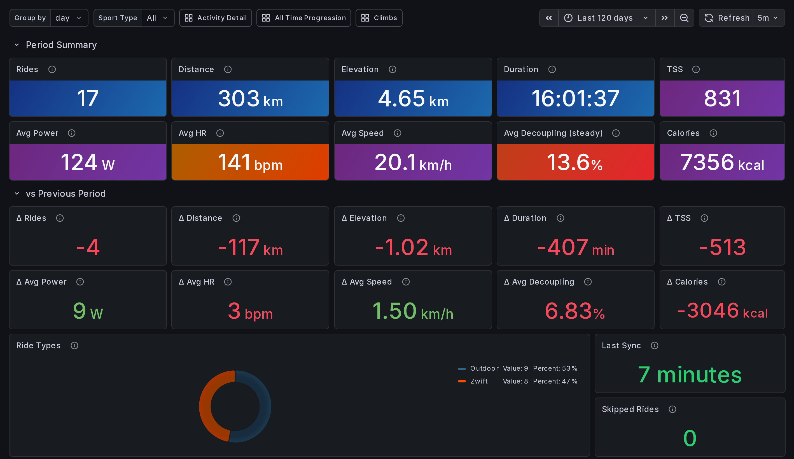
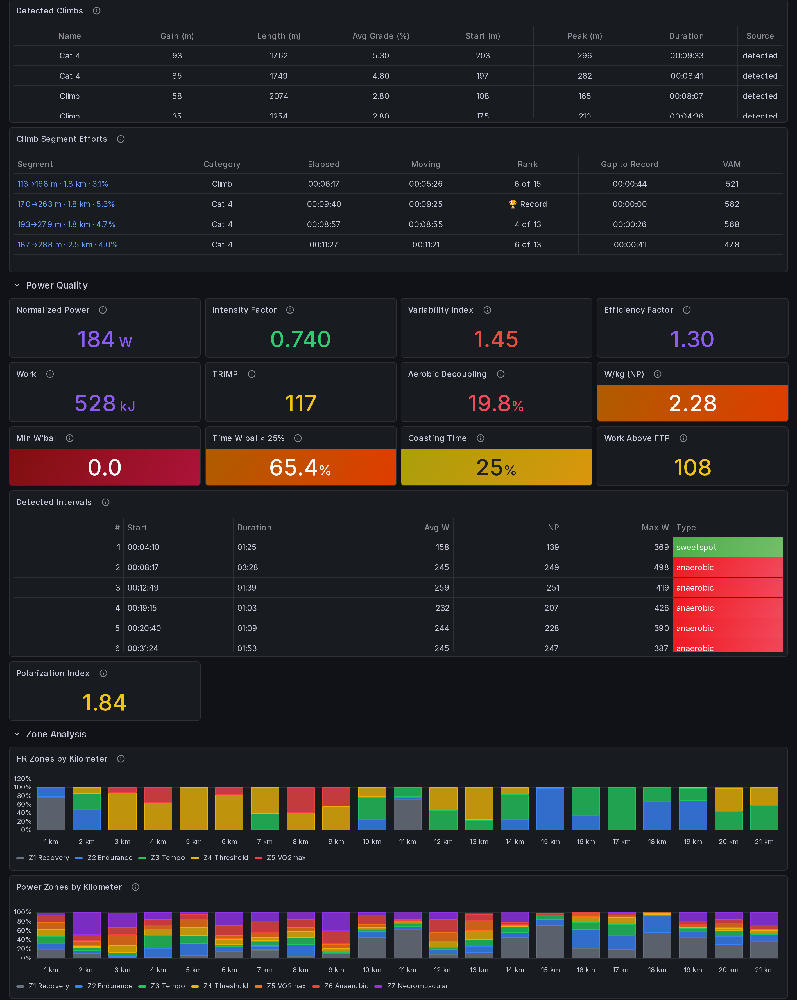
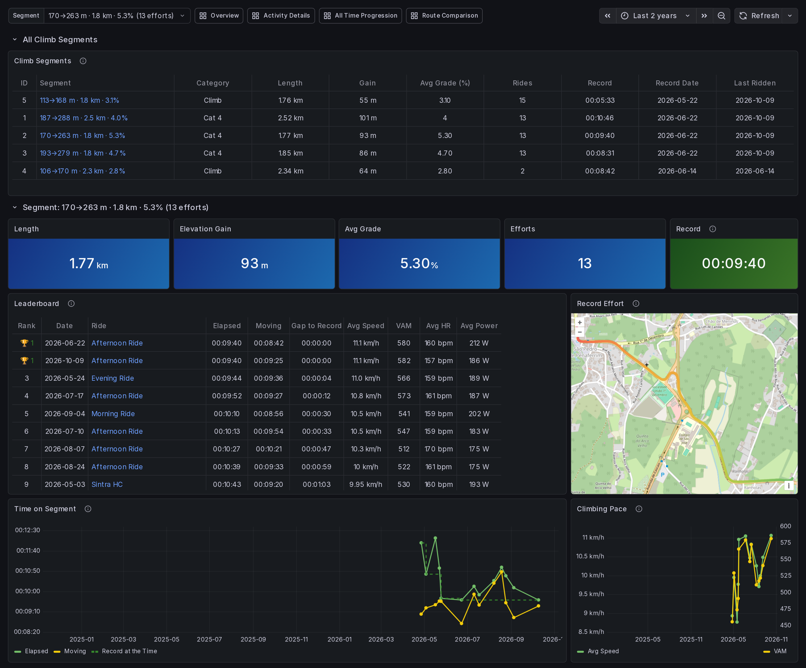
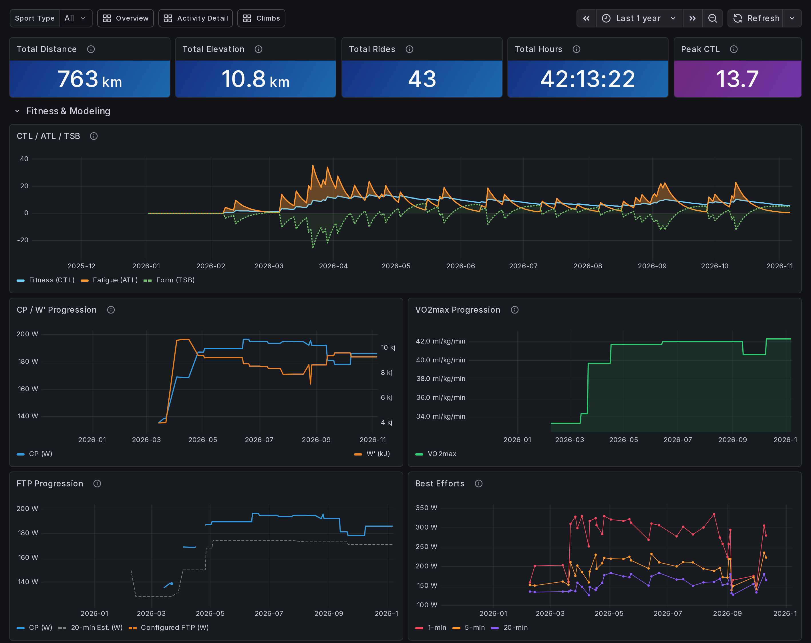
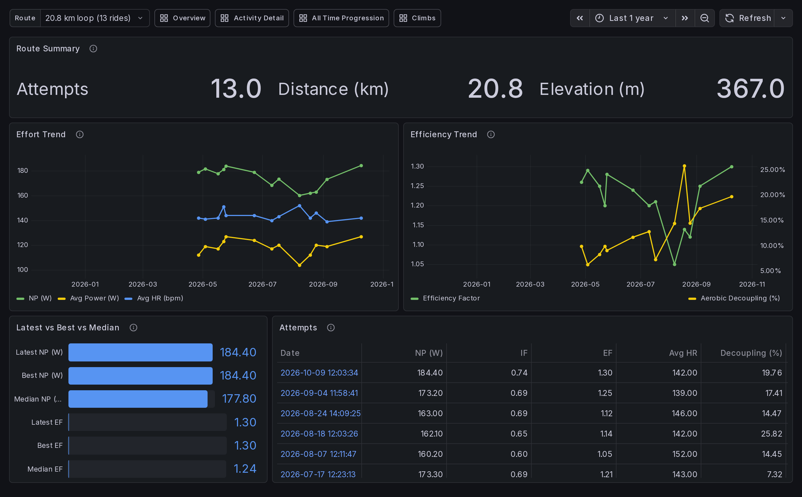
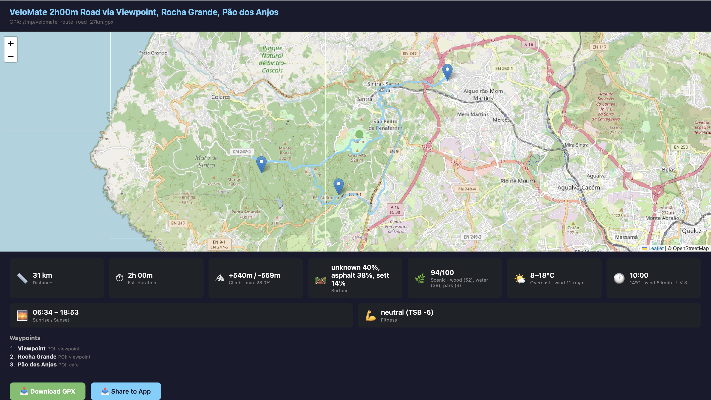

# VeloMate 🚴

[](https://github.com/elduty/velomate/actions/workflows/test.yml)
[](https://codecov.io/gh/elduty/velomate)
[](https://www.python.org/downloads/)
[](LICENSE)
[](https://grafana.com/)
[](https://ko-fi.com/elduty)

A self-hosted cycling data platform — automatic ride ingestion from **intervals.icu, Strava and/or Ride with GPS**, or straight from your own **FIT and GPX files**, Grafana dashboards for analytics, and intelligent route planning. **No paid subscription required** — all metrics (fitness, power zones, training load, TRIMP) are computed locally from raw data. intervals.icu is the recommended source: it is free, and it relays Garmin, Wahoo, Zwift, Polar, Suunto and Coros, so VeloMate does not depend on Strava API access — which now requires a paid subscription.

Inspired by [TeslaMate](https://github.com/teslamate-org/teslamate). Works with any device that syncs to intervals.icu, Strava or Ride with GPS, or that exports FIT or GPX files.



## Features

### Data Ingestion
- Polls intervals.icu (primary), Strava and/or Ride with GPS every 10 minutes (configurable) for new cycling rides — run any source on its own, or several with automatic cross-source deduplication of the same ride
- Imports FIT and GPX files, gzipped or in zips, from a watched folder or an optional upload page — no cloud account needed, and a file matching a ride you already have only fills its gaps (see [Importing files](#importing-files))
- **Cycling only** — from intervals.icu: Ride, VirtualRide, GravelRide, MountainBikeRide, EBikeRide, EMountainBikeRide, TrackRide and Cyclocross; from Strava: Ride, VirtualRide, EBikeRide, Handcycle and Velomobile. Runs, swims, walks, strength and everything else are filtered out at sync
- Classifies rides as: **Outdoor**, **Zwift**, **Indoor** (trainer), or **E-Bike** — dashboards can filter by type
- Stores full per-second telemetry (HR, power, cadence, speed, altitude, GPS)
- Calculates CTL/ATL/TSB fitness metrics locally (no Strava Premium needed)
- TRIMP (Training Impulse) computed from HR stream data with HRR capped at 1.0 (no Strava Premium needed)
- Normalized Power (NP), Intensity Factor (IF), Variability Index (VI), Efficiency Factor (EF), Work (kJ), aerobic decoupling, and W/kg pre-calculated per activity from stream data
- VI-aware TSS: uses avg_power instead of NP when VI > 1.30 (urban stop-and-go rides) to prevent overestimation
- Auto interval detection: Coggan-style classification (surge / tempo / sweetspot / threshold / vo2 / anaerobic) from power streams
- All derived metrics computed by the ingestor and stored — Grafana reads stored values (single source of truth)
- FTP auto-estimated from rolling 90-day best 20-minute power, or configured manually via `VELOMATE_FTP`
- Per-ride weight stored from `VELOMATE_WEIGHT` — enables W/kg tracking with historical preservation
- Daily fitness recalculation at 00:05 (rest days show CTL/ATL decay)
- Climb segments: a climb ridden twice becomes a fixed segment, and every ride over it is timed on GPS
- Smart deduplication when multiple devices record the same ride
- Ingest health: a poll only counts as successful if every enabled source really delivered, so a pipeline that looks fine while delivering nothing shows up as stalled, and a rest week doesn't

**Metric availability by ride type:**

| Metric | Outdoor | Zwift | Indoor (trainer) | E-Bike |
|--------|---------|-------|------------------|--------|
| GPS route map | Yes | No | No | Yes |
| Power zones / NP / EF | With power meter | Yes (virtual power) | With smart trainer | No |
| HR zones / TRIMP | With HR monitor | With HR monitor | With HR monitor | With HR monitor |
| Speed / distance | Yes | Virtual | No (0 km) | Yes |
| Elevation | Yes | Virtual | No | Yes |
| Per-km zone breakdown | Yes | Yes | No (no distance) | Yes |

> **No HR or power sensor?** A ride recorded with GPS only still shows distance, elevation, speed, the route map, and detected climbs. Training-load metrics — TSS, CTL/ATL/TSB, NP, IF, EF, VI, TRIMP, and power/HR zones — need a heart-rate or power sensor and read "N/A" without one.

### Grafana Dashboards

Five dashboards with 139 panels across 10 visualization types.

**Overview** (44 panels) — your training hub
- 10 period summary stats (Rides, Distance, Elevation, Duration, TSS, Avg Power, Avg HR, Avg Speed, Avg Decoupling, Calories) with sport type filter
- 10 delta comparison cards (vs previous period, including Δ Calories)
- Fitness section: CTL/ATL/TSB with fill-between shading, Form (TSB) stat on Friel's bands (high risk/productive/transitional/fresh/detraining), Configured + Estimated FTP side-by-side, estimated VO2max, load ratio (ATL/CTL), CTL ramp rate, training monotony and strain, weekly streak, days since ride, 6-week fitness delta, ride type donut
- Ingest health: last successful sync and rides skipped because intervals.icu can't re-serve them
- 7 trend charts (distance & elevation, duration & TSS, avg power & HR, avg speed & cadence, calories & rides, rolling weekly volume, weekly work below/above FTP)
- Ride frequency bar chart
- Activities table with drill-down to Activity Details
- Default time range: 7 days



**Activity Details** (44 panels) — per-ride deep dive
- 12 summary stat cards + 8 advanced metrics (NP, IF, VI, EF, Work, TRIMP, aerobic decoupling, W/kg)
- GPS route map with speed/HR/power color overlay
- HR and power zones by kilometer (stacked bar charts)
- HR and power zone distribution (Coggan model, zone-colored)
- Power distribution histogram (25W buckets, 7-zone colored)
- Power vs HR scatter plot (cardiac drift detection)
- Power zone bands on HR & Power telemetry
- Speed & elevation / HR & power / cadence & grade telemetry (distance-based x-axis)
- Per-km splits table with best/worst markers
- Power duration curve (full windows only, so a short ride shows no 60-minute best)
- W'bal (anaerobic battery) trace, Min W'bal and Time W'bal < 25%, against the W' the ride was modelled with
- Durability profile and index
- Coasting time, work above FTP and polarization index
- Detected climbs table
- Climb segment efforts on this ride, ranked against every other time you rode them
- Detected intervals table (Coggan-style: surge / tempo / sweetspot / threshold / vo2 / anaerobic)



**Climbs** (10 panels): the same climb compared across rides
- Segment list with record time, record date and last ridden. Click one to open it
- Leaderboard with elapsed and moving time, gap to the record, speed, VAM, and HR and power when recorded
- Record effort on a map
- Time on segment with the record at the time, and climbing pace, over the months
- A climb detected on two or more rides becomes a segment, and every ride passing both ends is timed on GPS, so a ride where detection missed the climb still counts
- Segments get an automatic name such as `170→263 m · 1.8 km · 5.3%`, in metric on either unit setting. Rename one with `docker exec velomate-ingestor python3 segments.py rename <id> "Name"`. `list` shows the ids, and an empty name restores the automatic one



**All Time Progression** (36 panels) — long-term trends
- 6 stat cards: total distance, elevation, rides, hours, current FTP, peak CTL
- 8 progression scatter plots with 10-ride rolling averages (speed, power, NP, EF, HR, distance, aerobic decoupling, NP/kg)
- VO2max progression trend (Sitko equation on best 5-minute power and that ride's weight)
- FTP progression (daily CP and 20-minute estimates) and CP / W' progression
- Best efforts (1min/5min/20min peak power per ride, full windows only)
- Weekly power range (candlestick — week-over-week comparison)
- Training zone polarization (monthly power + HR zone stacked bars + monthly interval distribution)
- CTL/ATL/TSB fitness history with fill-between shading
- 6 cumulative totals (distance, elevation, duration, rides, TSS, calories)
- Monthly trends stacked by ride type
- Year-over-year distance comparison
- Annual totals table
- Personal records with drill-down links
- All-time ride map



**Route Comparison** (5 panels) — same route, different days

- Route selector listing every route ridden more than once, most-ridden first
- Effort trend across attempts (NP, avg power, avg HR) and efficiency trend (EF, aerobic decoupling)
- Latest attempt against the route's best and median
- Attempts table with drill-through to Activity Details

Routes are detected automatically from GPS: each ride is reduced to a set of
~111 m grid cells, and rides whose cells overlap by 70% or more are the same
route. Matching is direction-agnostic, so riding a loop the other way still
counts, and unaffected by pauses or where on a loop the ride started. Rides
without usable GPS — indoor and virtual — have no route and do not appear.

Progress here is measured by **effort, not elapsed time**. On a stop-and-go
route elapsed time mostly measures traffic lights, so a faster day is often a
luckier one rather than a fitter rider.

### Alerts

Three rules are provisioned and evaluated hourly:

| Alert | Fires when |
|-------|------------|
| Ingestion Stalled | No successful poll for 6+ hours |
| Overtraining Warning | Form (TSB) is below -30 on both of the last two days |
| Detraining Warning | No ride for more than 5 days |

No contact point is provisioned, so they only show on Grafana's alert page. To be notified, add a contact point under **Alerting → Contact points**, then select it on the default policy under **Alerting → Notification policies**, because a new contact point receives nothing until a policy routes to it.



### Intelligent Route Planning
- Generates real road-following GPX loops via [Valhalla](https://github.com/valhalla/valhalla) (free, OpenStreetMap-based)
- Generates GPX files with interactive browser preview (map + route stats + download/share buttons)
- On iOS/Android, the share button opens the native share sheet to send the GPX directly to any bike computer app
- `--output DIR` saves the preview HTML to a directory for headless/server use
- Smart waypoint selection from 10 data sources (see below)
- Weather-aware: best ride time, UV warnings, wind direction analysis
- Safety control: `--safety` flag adjusts preference for bike lanes vs main roads
- Road safety check: the router is asked what every route rides on before you see it. Motorways, trunk roads, their links and IC/IP routes are never used: the planner excludes the stretch it hit and routes again, up to three times, then fails with `no_safe_route` and names the road rather than falling back to it
- Roads closed to bicycles are left to the router's bicycle costing, which refuses what its map data closes to bicycles
- Busy or fast roads are legal, so they don't fail a route. Primary roads and limits of 90 km/h or more are listed in the plan with their distance, and `--safety` is what steers away from them
- If the check can't run the plan fails instead of giving you an unchecked route. A route over the router's limit of 16,000 shape points, roughly 360 km, is too long for it
- Avoid zones are hard exclusions: routes stay out of them, and a plan fails with a clear message rather than ignoring one
- Overpass can be slow, and each of its calls may wait 60 seconds, so a plan can take a few minutes. If a call fails, the plan goes ahead without that data and logs the error

## Route Intelligence — 10 Data Sources

When planning a route, VeloMate selects waypoints and enriches the output using:

| # | Source | Data | API |
|---|--------|------|-----|
| 1 | **OpenStreetMap POIs** | Viewpoints, cafes, peaks, water fountains, bike shops | Overpass (free) |
| 2 | **Strava segments** | Popular cycling roads near you | Strava API |
| 3 | **Komoot highlights** | Community-curated cycling POIs | Vector tiles (free, no auth) |
| 4 | **Your ride history** | 30-day GPS density grid — variety or comfort mode | Local DB |
| 5 | **OSM surface tags** | Road surface verification (asphalt, gravel, etc.) | Overpass (free) |
| 6 | **OSM cycling infrastructure** | Bike lanes, speed limits, traffic calming → safety score | Overpass (free) |
| 7 | **Open-Meteo weather** | Temperature, wind, UV, rain + hourly forecast | Open-Meteo (free) |
| 8 | **Open-Meteo air quality** | European AQI, PM2.5, PM10 | Open-Meteo (free) |
| 9 | **Open Topo Data** | Elevation profile, climb/descent, max gradient | Open Topo Data (free) |
| 10 | **Sunrise/Sunset** | Daylight safety, golden hour | sunrise-sunset.org (free) |

Additionally, the route planner detects **waymarked cycling trails** (EuroVelo, national routes) along the generated path.

## Deduplication — Data Richness Scoring

When multiple devices record the same ride (e.g., a bike computer and a watch both syncing to Strava), VeloMate keeps the record with the richest data:

| Field | Score |
|-------|-------|
| Power data | +3 |
| Heart rate | +2 |
| Distance > 0 | +1 |
| Cadence | +1 |
| Calories | +1 |
| Elevation > 0 | +1 |

Across sources, intervals.icu takes precedence, and Strava and Ride with GPS rank equally. The score decides between records of the same rank, so it works with any device brand. Missing fields from the losing record (e.g., HR from a watch when a bike computer wins on power) are merged into the winner. The merge updates the stored ride in place, so its id, route, weight and Strava segment climbs survive.

Imported files rank below every cloud source. A file matching a ride you already have only fills its gaps: an empty column, or a whole stream the ride lacks (power from a head unit on a phone recording, say), and never replaces what the cloud copy has.

## Architecture

```
Any device → intervals.icu / Strava / Ride with GPS ─┐
FIT / GPX files → import folder / upload page ───────┴→ [Ingestor] → PostgreSQL → Grafana dashboards
                                                             ↑
                                      VeloMate CLI (route planning + recommendations)
                                                             ↓
                                                    Valhalla → GPX file
```

Three Docker Compose services, plus an optional fourth:

| Service | Image | Port |
|---------|-------|------|
| PostgreSQL | `postgres:15` | 5423 |
| Ingestor | custom Python 3.11 | — |
| Grafana | custom, on `grafana/grafana:12.4` | 3021 |
| Upload page (optional, `COMPOSE_PROFILES=upload`) | the ingestor image | 3022 |

The CLI runs locally and connects to the database over the network.

## Quick Start

### 1. Clone and configure

```bash
git clone https://github.com/elduty/velomate.git
cd velomate
cp .env.example .env
# Edit .env with your activity source credentials and passwords
```

### 2. Connect an activity source

Configure any of them, or none and import files instead. Several can run
together — the same ride arriving from more than one is deduplicated
automatically, with intervals.icu taking precedence.

#### intervals.icu (recommended)

Free, with a documented API, and it relays Garmin Connect, Wahoo, Zwift, Polar,
Suunto and Coros — so VeloMate needs no Strava API access of its own.

1. Sign in at [intervals.icu](https://intervals.icu) → **Settings**
2. Scroll to **Developer Settings** — your **athlete ID** (`iNNNNNN`) and
   **API key** are both on that page
3. Add them to `.env` as `INTERVALS_ICU_ATHLETE_ID` and `INTERVALS_ICU_API_KEY`

**One caveat worth knowing:** activities that reached intervals.icu *via
Strava* cannot be served back through their API — Strava's terms forbid third
parties re-serving Strava data — so those are skipped and reported per batch.
Upload to intervals.icu directly, or sync your head unit to it, for full
coverage.

##### Zwift rides — connect Zwift to intervals.icu directly

**intervals.icu → Settings → Zwift → Connect.** Zwift and intervals.icu have an
official integration built on Zwift's Training API: completed rides download
automatically, **Download Old Data** backfills up to a year, and planned
workouts sync the other way into your Zwift workout library. Nothing runs on
your machine and nothing depends on Strava.

The alternatives below are recorded because they look workable and are not.

**Relaying through Garmin or Wahoo does not work.** Both deliberately refuse to
forward third-party-sourced activities to other platforms, so a Zwift ride that
lands in Garmin Connect or the Wahoo app never reaches intervals.icu at all.

**Strava holds the ride, but neither way of getting it out is open.** These are
two alternative routes, each blocked for its own reason — opening either one
would be enough:

- *Via intervals.icu.* The ride arrives there, but as one of the unavailable
  stubs described above, which intervals.icu may not re-serve through its API.
- *Straight from Strava.* VeloMate could read the original FIT directly, but
  Strava's API now requires a paid subscription. Buying one reopens this route.

(intervals.icu can also bulk-import a full Strava history as original FIT files.
That is a one-off account export, not a sync route.)

**If the direct connection is ever unavailable**, Zwift writes every completed
ride to `~/Documents/Zwift/Activities`, and intervals.icu accepts both a manual
upload and a watched Dropbox folder (**Settings → Dropbox → Connect → Add
Folder**). Either gets a ride in without any custom tooling.


#### Ride with GPS

1. Go to [ridewithgps.com](https://ridewithgps.com) → account settings → **Developers** tab
2. Create an API client — this gives you the **API key**
3. Generate an **auth token** for your account on the same page
4. Add both to `.env` as `RWGPS_API_KEY` and `RWGPS_AUTH_TOKEN`

#### Strava

Strava API access requires a **paid Strava subscription** as of June 2026, so
prefer intervals.icu unless you specifically need Strava. The code path is
unchanged and re-enables whenever the credentials are set.

```bash
# Set your Strava API credentials (from https://www.strava.com/settings/api)
export STRAVA_CLIENT_ID=your_client_id
export STRAVA_CLIENT_SECRET=your_client_secret

# Run the auth flow
python3 -m velomate.cli auth

# Follow the prompts: open the URL, approve on Strava, paste the redirect URL back.
# Add the printed refresh token to your .env file.
```

When several sources are configured, the same ride arriving from more than one
is deduplicated automatically, and intervals.icu takes precedence.

No cloud source is required: rides can come from files alone (below).

#### Importing files

Set `VELOMATE_IMPORT_DIR` in `.env` to a host folder of ride files, as an
absolute path (`/srv/rides`) or one starting with `./` (relative to the compose
file). Any other value, a bare name such as `rides` included, is read by
Compose as a volume name and the stack won't start. Leave it empty or unset to
turn the folder off. Compose mounts the folder read-only at `/app/import`, and
the ingestor scans it at startup and on every poll. The ingestor runs as an
unprivileged user (`app`), not root, so the folder and everything in it must be
readable by other users on the host (`chmod -R o+rX /srv/rides`, for example).

It reads `.fit` and `.gpx` files, gzipped or not, including inside `.zip`
archives, in any subfolder, so a Garmin or Strava bulk export can go in whole.
Other files are skipped without a mention, `.tcx` and `.tcx.gz` included: a
Strava export keeps each ride in the format it was uploaded in, so a ride that
arrived as TCX has to be exported again as FIT or GPX. Symlinks inside the
folder are skipped. Files are never moved, renamed or deleted. A file is read
again only when its size or modification time changes, and a pass is
time-bounded, so a big first load spreads over several polls. The backfill
window (`VELOMATE_BACKFILL_MONTHS`) doesn't apply to files.

A GPX track's `<type>` decides whether it is a ride. A word naming another
sport (`running`, `hiking`) makes it `not_cycling`. A number is an activity
code, and only `1` counts as a ride, so a GPX with any other number is skipped
as `not_cycling`; import that ride from its FIT file instead. A heart rate
outside 20-260 bpm, a cadence above 250 rpm or a power above 3,000 W is taken
as a glitch and dropped from that sample, and a file whose times span more than
7 days is `failed`.

Each ride file gets one outcome, logged by the ingestor as
`[file] <name>: <outcome>` and kept in the `imported_files` table:

| Outcome | Meaning |
|---|---|
| `imported` | A new ride |
| `merged` | The ride was already stored from another source, and the file added something it lacked, such as power or heart rate |
| `duplicate` | The ride was already stored and the file added nothing |
| `not_cycling` | Not a ride (a run, a walk), so it was skipped |
| `failed` | The file couldn't be read, with the reason |

A file whose bytes were seen before isn't parsed again, whatever it's called.
When the folder is set, it counts toward ingest health like a cloud source.

#### Upload page

The second way in is a web page for uploading ride files from a browser. It is
off by default: an install without it gets no extra container and no extra port.
Turn it on by setting `COMPOSE_PROFILES=upload` in `.env` and running
`docker compose up -d --build`. It listens on host port `3022`; set
`UPLOAD_PORT` to change that.

Sign in with a Grafana login. Only an Editor or Admin in Grafana's main
organisation can upload, and Grafana's basic auth must stay enabled (it is by
default) because the page checks your login against it. The page takes the same
files as the watched folder (`.fit`, `.gpx`, gzipped or in a `.zip`), up to
500 MB per upload. For anything bigger, use the watched folder above. The
fitness figures are recalculated shortly after the last upload.

A `.zip` is imported in one request, so a reverse proxy in front of the page
needs a long read timeout (several minutes for a big archive). For an archive
with many rides, use the watched folder instead.

The service speaks plain HTTP and sends your login as Basic auth, so keep it on
a trusted LAN or put a TLS reverse proxy in front of it. The proxy is also the
place to bound slow clients (read and send timeouts).

### 3. Start services

```bash
docker compose up -d
```

On first run against an empty database, the ingestor backfills the last 12 months of activities from each configured source. Configure the window via `VELOMATE_BACKFILL_MONTHS` (set to `0` for full history). Increasing this value on a running deployment auto-triggers a re-backfill on the next restart, and that is also how an install that already holds rides pulls intervals.icu history: adding intervals.icu to one does not backfill by itself. Rides intervals.icu received from Strava can't be fetched from it, so a backfill skips them.

### 4. Set up the CLI

```bash
pip install -r requirements.txt
cp config.example.yaml ~/.config/velomate/config.yaml
# Edit with your home coordinates, DB host, and activity source credentials
```

Credentials support three methods: direct values, environment variables, or shell commands (`password_cmd`) for secret managers like Keychain, 1Password, or Vault.

## CLI Usage

```bash
# Weekly ride recommendation (fitness + weather + past routes)
python3 -m velomate.cli

# Plan a route
python3 -m velomate.cli plan --duration 2h
python3 -m velomate.cli plan --distance 50km --surface gravel
python3 -m velomate.cli plan --duration 3h --waypoints "Sintra,Cascais"
python3 -m velomate.cli plan --duration 1h --surface mtb --safety 1.0
python3 -m velomate.cli plan --distance 30 --preference comfort

# Plan a route to a destination
python3 -m velomate.cli plan --destination Cascais
python3 -m velomate.cli plan --destination "38.69,-9.42" --surface gravel

# Destination with waypoints along the way
python3 -m velomate.cli plan --destination Cascais --waypoints "Oeiras;Estoril"

# There-and-back via destination
python3 -m velomate.cli plan --destination Cascais --loop

# Padded to target distance
python3 -m velomate.cli plan --destination Cascais --distance 50km
```

### Plan flags

| Flag | Default | Description |
|------|---------|-------------|
| `--duration` | * | Ride time (`2h`, `1h30m`, `90min`) |
| `--distance` | * | Target distance (`30`, `50km`) |
| `--destination` | — | End point — place name or `lat,lng`. Auto-disables loop |
| `--surface` | `road` | `road`, `gravel`, or `mtb` |
| `--safety` | `0.5` | 0.0 = fastest, 1.0 = safest (prefers bike lanes). The road safety check runs at every setting |
| `--preference` | `variety` | `variety` (new roads) or `comfort` (familiar) |
| `--waypoints` | — | Semicolon-separated locations (`Cascais;38.7,-9.14;Sintra`) |
| `--date` | `tomorrow` | When to ride (`today`, `saturday`, `2026-03-20`) |
| `--time` | — | Start time (`14:00`, `2pm`, `9am`) |
| `--start` | from config | Start location — place name or `lat,lng` |
| `--loop` | true** | Round-trip route |
| `--output DIR` | — | Save preview HTML to directory (instead of opening browser) |

\* Provide `--duration` or `--distance` (one required unless `--destination` is set, mutually exclusive). A bare `--destination` routes direct; add either flag to pad the route to that length. \*\* Loop defaults to false when `--destination` is set.

### Example output

```
🗺 *VeloMate 2h00m Road via Miradouro de Porto Salvo, Cotão, Viewpoint*
  📏 24 km
  📅 2026-03-16 at 09:00
  🛤 Surface: asphalt 53%, unknown 44%, paving_stones 2%
  ⛰ Climb: +260m / -284m (max gradient 10.2%)
  🌿 Scenic: wood (25), water (10), park (4) (86/100)
  🛡 Safety: bike lanes 22% (11/100)
  🌤 Mainly clear, 10-21°C, wind 12 km/h
  🕐 Best time: 09:00 (14°C, wind 10 km/h, UV 2)
  🌅 Sunrise 06:45, sunset 18:46
  💪 transitional (TSB -4)
  💾 GPX: /tmp/velomate_route_road_29km.gpx
```

## Fitness Metrics

```
Power TSS = (duration_s × P × IF) / (FTP × 3600) × 100     where P is VI-aware
            — P = NP when VI ≤ 1.30 (Coggan standard)
            — P = avg_power when VI > 1.30 (high-variability urban rides)
HR TSS    = (duration_h) × (avg_hr / LTHR)² × 100          (fallback, no power)
CTL       = 42-day EMA of daily TSS   (chronic training load / fitness)
ATL       = 7-day EMA of daily TSS    (acute training load / fatigue)
TSB       = CTL − ATL                 (training stress balance / form)
```

- **NP**: Normalized Power — 30-second SMA (circular buffer), 4th power, mean, 4th root. Matches GoldenCheetah IsoPower (Coggan standard). Computed and stored on every power ride
- **VI-aware TSS**: The Coggan NP model is calibrated for VI ≈ 1.0–1.2. On rides with VI > 1.30 (urban stop-and-go, crit-style surges, technical MTB) the 4th-power weighting overestimates sustained load. VeloMate switches to avg_power-based TSS above this boundary so high-VI rides get a physiologically realistic TSS. Steady rides (the majority) are unaffected
- **IF**: Intensity Factor — computed from the same power used for TSS (NP or avg_power depending on VI) divided by per-ride FTP, so `TSS ≈ duration_h × IF² × 100` holds on every ride
- **VI**: Variability Index = NP / avg_power. Higher = more variable effort. Drives the VI-aware TSS routing above
- **EF**: Efficiency Factor = NP / avg HR. Rising EF indicates improving aerobic fitness
- **TRIMP**: Banister exponential formula from per-second HR data. Uses max HR for HRR normalization. HRR capped at 1.0 to prevent blowup when HR exceeds configured max
- **Aerobic decoupling**: `(first_half_EF / second_half_EF − 1) × 100`. Positive = cardiac drift. Coasting samples are excluded, so it measures efficiency while actually pedalling. Requires **20 minutes of pedalling** — heart rate lags effort by minutes, so on a shorter ride the first half is mostly HR still climbing, which reads as drift that never happened; shorter rides store no value rather than a misleading one. Computed per ride by the ingestor, stored on `activities.aerobic_decoupling`, trended on All Time Progression
- **FTP**: auto-estimated from rolling 90-day best 20-minute power × 0.95, or configured via `VELOMATE_FTP`. The algorithmic estimate is always computed and stored as a diagnostic value alongside the configured one — Overview shows both side-by-side so a mismatch is visible at a glance
- **Work**: Total energy output in kJ = sum of per-second power from stream data
- **Max HR**: 95th percentile of ride max HRs, or configured via `VELOMATE_MAX_HR`. Used for Banister TRIMP
- **LTHR (Lactate Threshold HR)**: derived as ~89% of max HR per Friel convention. Used as the threshold value in HR-based TSS when no power stream is available
- **W/kg**: NP / ride_weight. Uses NP (not avg_power) because it better reflects the physiological cost of variable efforts. Per-ride `ride_weight` stored from `VELOMATE_WEIGHT` — historical rides preserve their weight if the setting changes later. Shown on Activity Details and as NP/kg Trend on All Time Progression
- **CP / W'**: Critical Power and W' modeled via Monod-Scherrer fit on mean maximal power at standard durations. Replaces rolling 20-min x 0.95 as the algorithmic FTP estimate when fit quality is good (R² >= 0.9). Graceful fallback to the old method when data is sparse. CP is the aerobic ceiling, W' is the anaerobic reservoir
- **W'bal**: Per-second anaerobic battery gauge, using the CP and W' current on the ride's own date. It drains above CP and refills exponentially below it, using Skiba's 2012 recovery constant recomputed each second, so values can differ from GoldenCheetah and intervals.icu. Shows when you drained your reservoir, how close to empty you got, and where it refilled. Displayed on Activity Details alongside the power trace
- **VO2max**: `16.6 + 8.87 × W/kg` (Sitko et al. 2022), from the best 5-minute power in the last 90 days and that ride's weight. Full 300-sample windows only. The equation was fitted on road cyclists doing an all-out 5-minute test, so it reads low unless a ride held a maximal 5 minutes. Stat card on Overview, VO2max Progression trend on All Time Progression
- **Auto interval detection**: Efforts from 75% FTP up, classified by mean power on contiguous %FTP bands (tempo / sweetspot / threshold / vo2 / anaerobic); anything under 60 s is a surge, the stop-and-go accelerations of urban riding. Stored in the `ride_intervals` table. Classification uses per-ride FTP for historical accuracy
- **Power zones**: Coggan 7-zone model, binned at each ride's stored FTP, the same one IF and intervals use, so a past ride isn't re-zoned at today's FTP. A ride with no stored FTP falls back to the configured or estimated value
- **Load ratio**: ATL / CTL, on Garmin's bands (low < 0.8, optimal 0.8–1.4, high 1.5–1.9, very high ≥ 2.0). Garmin defines those for its own load model, so treat them as a guide. It's noisy at low CTL, where one ordinary ride can reach the top band
- **Climbs**: detected from smoothed altitude over GPS distance. A segment has to rise at 1% or more on its own to join a climb, so flat approaches don't dilute it, and a climb needs at least 200 m at 2%. Rides without GPS get no detected climbs
- **Climb segments**: a climb detected on two or more rides, with starts within 600 m and summits within 150 m, becomes a fixed segment. A ride counts if it passes within 40 m of the start, then of the end, over a path no longer than 1.3 times the segment, so riding it downhill or by a detour doesn't. The record is elapsed time, which includes stops. Moving time counts time above 2 km/h
- **TSB interpretation** (Friel's scale): < -30 high risk · -30 to -10 productive · -10 to +5 transitional · +5 to +25 fresh · > +25 detraining

## Database Schema

| Table | Contents |
|-------|----------|
| `activities` | Every ride — distance, duration, HR, power, cadence, elevation, calories, TSS, NP, IF, VI, EF, TRIMP, Work (kJ), aerobic decoupling, ride FTP, the CP and W' its W'bal was modelled with, sport type, device |
| `activity_streams` | Per-second telemetry — HR, power, cadence, speed, altitude, lat/lng |
| `ride_intervals` | Auto-detected intervals with duration, power, classification (surge/tempo/sweetspot/threshold/vo2/anaerobic) |
| `ride_climbs` | Detected climbs, plus Strava segment climbs where they were imported |
| `climb_segments` | Recurring climbs, fixed once found, with an optional name |
| `climb_efforts` | Every time a ride went over a segment |
| `climb_segment_scans` | Which rides have been matched against which segment |
| `ride_routes` | Routes detected from GPS, with the ride that founded each |
| `cp_estimates` | Daily CP and W' estimates |
| `athlete_stats` | Daily fitness metrics — CTL, ATL, TSB, weekly volume |
| `routes` | Legacy — created by schema but not actively written to |
| `sync_state` | Ingestor bookmarks + configured/estimated FTP + metrics version + ingest health |
| `imported_files` | Every imported ride file by content hash, with its outcome and the ride it became |
| `imported_paths` | Watched-folder files already read, by path, size and modification time |

Schema is managed in code (`ingestor/db.py:create_schema()`) using `IF NOT EXISTS` / `ADD COLUMN IF NOT EXISTS`. No migration tool.

## Configuration

### Ingestor (Docker)

Configured via `.env` file:

| Variable | Required | Description |
|----------|----------|-------------|
| `POSTGRES_PASSWORD` | Yes | Database password |
| `POSTGRES_DB` | No | Database name (default `velomate`) |
| `POSTGRES_USER` | No | Database user (default `velomate`) |
| `POSTGRES_PORT` | No | Host port mapped to PostgreSQL 5432 (default `5423`) |
| `POSTGRES_VERSION` | No | PostgreSQL image tag (default `15`) |
| `STRAVA_CLIENT_ID` | No | From strava.com/settings/api |
| `STRAVA_CLIENT_SECRET` | No | From Strava API settings |
| `STRAVA_REFRESH_TOKEN` | No | OAuth refresh token (get via `python3 -m velomate.cli auth`) |
| `RWGPS_API_KEY` | No | From ridewithgps.com → account settings → developers |
| `RWGPS_AUTH_TOKEN` | No | Generated on the RWGPS API client management page |
| `INTERVALS_ICU_ATHLETE_ID` | No | From intervals.icu → Settings → Developer Settings (`iNNNNNN`) |
| `INTERVALS_ICU_API_KEY` | No | On the same Developer Settings page |
| `INTERVALS_ICU_SYNC_WINDOW_DAYS` | No | Rolling poll window in days (default `14`) |
| `INTERVALS_ICU_SWEEP_DAYS` | No | Daily reconciliation window, in days (default `90`). The sweep mirrors deletions and ingests up to 25 rides a day that exist on intervals.icu but not locally |
| `VELOMATE_IMPORT_DIR` | No | Host folder of FIT/GPX files to import, mounted read-only. Files are never moved or deleted. An absolute path or one starting with `./`; empty or unset turns it off (see [Importing files](#importing-files)) |
| `COMPOSE_PROFILES` | No | Set to `upload` to start the upload page (see [Upload page](#upload-page)). Empty by default |
| `UPLOAD_PORT` | No | Host port for the upload page (default `3022`) |
| `GRAFANA_URL` | No | Where the upload page checks sign-ins (default `http://velomate-grafana:3000`). Change it if Grafana runs elsewhere |
| `GRAFANA_PASSWORD` | Yes | Grafana admin password |
| `GRAFANA_PORT` | No | Host port for the Grafana UI (default `3021`) |
| `GRAFANA_ROOT_URL` | No | Public URL if served behind a reverse proxy (default `http://localhost:3021/`) |
| `GRAFANA_VERSION` | No | Base image tag for the Grafana build (default `12.4.0`). Changing it needs `docker compose up -d --build` |
| `VELOMATE_MAP_BASELAYER` | No | Basemap for the map panels, as Grafana layer JSON (default OpenStreetMap, no key). For a keyed Carto or your own tile server: `{"type":"xyz","config":{"url":"https://your.tiles/{z}/{x}/{y}.png","attribution":"Your tiles"}}` |
| `GF_AUTH_ANONYMOUS_ENABLED` | No | Set `true` to allow anonymous Grafana viewing. **Trusted networks only, never on a reachable Grafana:** a viewer can send any query to the data source, and VeloMate's connects as the database superuser, so anonymous access can read or destroy everything |
| `GF_SERVER_SERVE_FROM_SUB_PATH` | No | Set `true` when serving Grafana under a sub-path |
| `POLL_INTERVAL_MINUTES` | No | How often to poll each activity source, in minutes (default `10`) |
| `VELOMATE_MAX_HR` | No | Your max heart rate (0 = auto-estimate). A decimal is rounded; a value that can't be read is logged and the last good one kept, for this and the next two settings |
| `VELOMATE_FTP` | No | Your FTP in watts (0 = auto-estimate) |
| `VELOMATE_RESTING_HR` | No | Resting heart rate in bpm (default 50) |
| `VELOMATE_WEIGHT` | No | Your weight in kg (0 = disabled). Enables W/kg on Activity Details and NP/kg Trend on All Time Progression. Stored per ride — historical rides preserve their weight if you change it later |
| `VELOMATE_RESET_RIDE_FTP` | No | Set to `1` to reset all per-ride FTP values on next restart (one-shot) |
| `VELOMATE_TOKEN_FALLBACK` | No | Where a rotated Strava refresh token is written (default `/app/data/.strava_refresh_token`) |
| `VELOMATE_BACKFILL_MONTHS` | No | How far back to fetch activities. Default `12`. Set to `0` for full history (slow — can take hours and span multiple days due to rate limits). **Increasing this value on a running deployment** triggers an auto-backfill on the next restart to pull the extended window. Decreasing it logs a note but leaves existing older activities in the DB (this controls the backfill horizon, not data retention). |
| `VELOMATE_UNITS` | No | Display units for dashboards and CLI: `metric` (default) or `imperial` (USA: mi/ft/mph/°F). Storage stays metric; this only changes what's displayed. The dashboard set is built into the Grafana image — no runtime switching. |

### Units

The `VELOMATE_UNITS` flag controls whether dashboards and CLI output show metric or imperial units. **Storage is always metric** — the conversion is display-only. Set to `metric` (default) for km, m, km/h, °C, or `imperial` for mi, ft, mph, °F. W/kg always stays metric. This is a build-time setting — changing it requires `docker compose up -d --build`; there's no runtime unit switcher.

Dashboards are not converted at query time: `scripts/gen_imperial_dashboards.py` generates a full imperial variant into `grafana/dashboards/imperial/`, and the Grafana image is built with whichever set the flag names. **Re-run that script after editing any dashboard under `grafana/dashboards/metric/`**, or the imperial set silently drifts from the metric one. Use exactly `metric` or `imperial` — any other value fails the build.

Dashboards and provisioning live in the image, so after changing either, run `docker compose up -d --build` to see it.

### CLI (local)

Configured via `~/.config/velomate/config.yaml` (see `config.example.yaml`):

- Home coordinates (required for route planning)
- Database connection
- Strava credentials (optional — enables popular segment data in route intelligence)
- Avoid zones (lat/lng areas to exclude from routes; zones out of the route's reach are left out, and the public Valhalla server refuses more than 10 km of perimeter across the rest, where a 500 m zone is about 3.2 km)

## Development

```bash
python3 -m pytest tests/ -q
```

Modules that need a real PostgreSQL skip in that run. Run each in its own process against a throwaway database, which they wipe, so its name must have `test` starting a word:

```bash
VELOMATE_TEST_DATABASE_URL=postgresql://user@localhost/velomate_test python3 scripts/run_pg_tests.py
```

CI runs on the ingestor image's Python, 3.11. After changing any dashboard SQL, also run `tests/test_every_dashboard_query.py` against that database.

## Requirements

- Docker + Docker Compose (for ingestor, PostgreSQL, Grafana)
- Python 3.10+ (for CLI)
- At least one activity source. **intervals.icu is recommended** — free, and it relays
  Garmin, Wahoo, Zwift, Polar, Suunto and Coros. Strava and Ride with GPS also work;
  note that Strava API access now requires a paid Strava subscription

## License

[AGPL-3.0](LICENSE) — same license as [TeslaMate](https://github.com/teslamate-org/teslamate). Free to use, modify, and self-host. Modifications must be shared under the same license.
